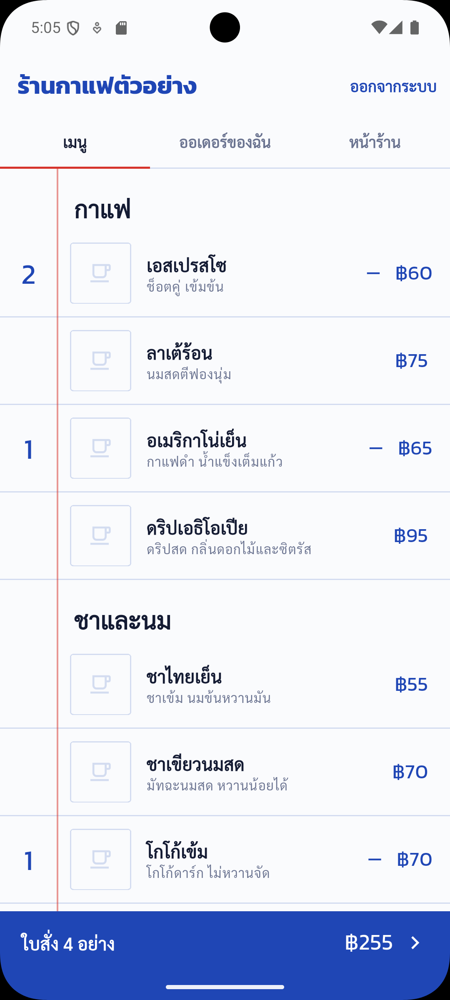
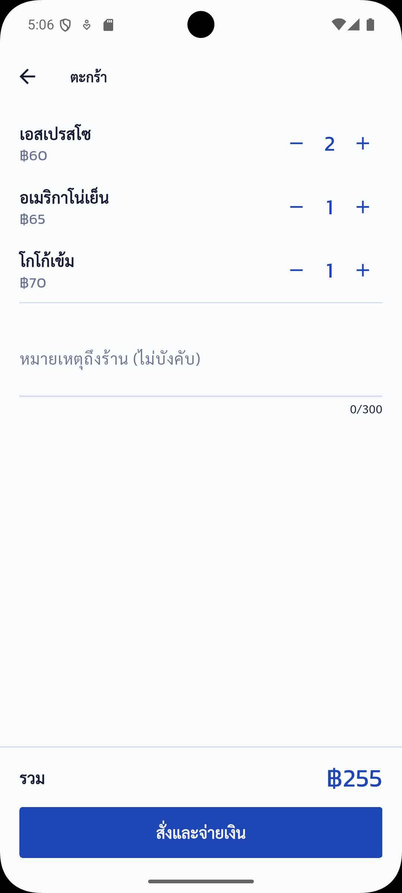
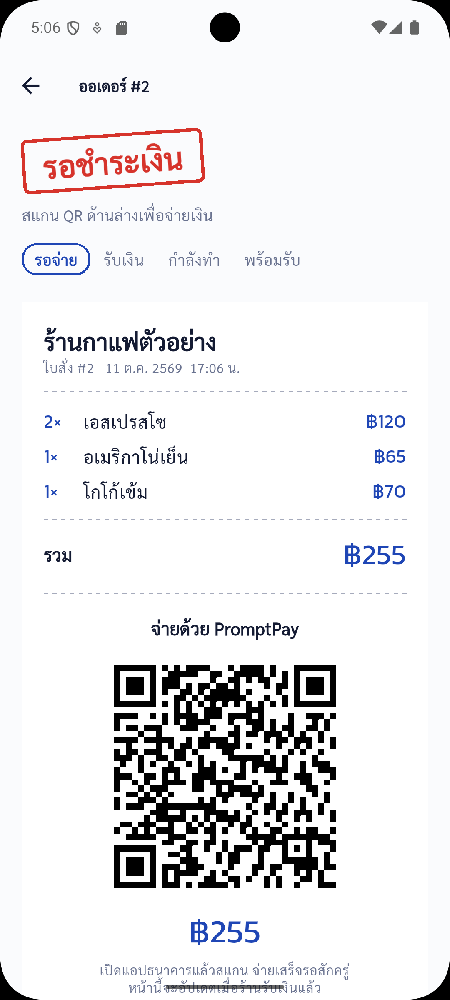
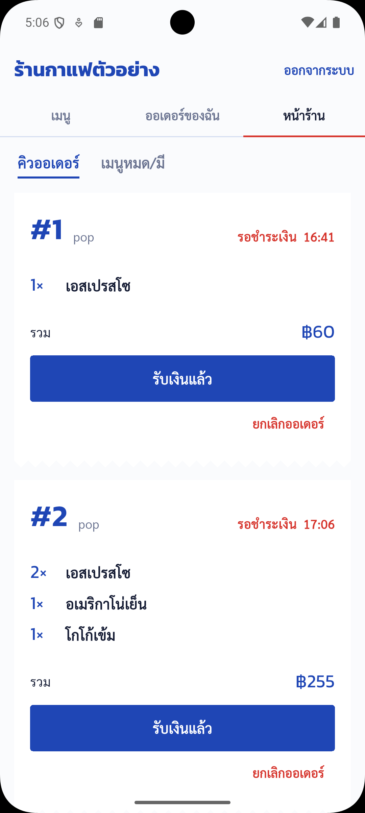

# order_demo_app

แอปสั่งของสำหรับร้านกาแฟ/ร้านอาหาร จ่ายด้วย PromptPay QR เป็นงานตัวอย่างในพอร์ตโฟลิโอ
ใช้คู่กับ backend [order-demo-backend](https://github.com/kitchu-studio/order-demo-backend)

| เมนู | ตะกร้า | ใบสั่งและ QR | หน้าร้าน |
|---|---|---|---|
|  |  |  |  |

## ฟีเจอร์

- สมัคร/เข้าสู่ระบบ ต่ออายุ token อัตโนมัติ
- เลือกเมนูใส่ตะกร้า สั่ง และจ่ายด้วย PromptPay QR (สร้างจากยอดจริงของออเดอร์)
- ติดตามสถานะออเดอร์แบบสด: รอจ่าย, ร้านรับเงินแล้ว, กำลังทำ, พร้อมรับ
- มุมมองเจ้าของร้าน: คิวออเดอร์ กดเปลี่ยนสถานะทีละขั้น และกดเมนูหมด/มีของ

## เทคโนโลยี

Flutter 3.35, Riverpod, Dio, flutter_secure_storage, qr_flutter, google_fonts

## วิธีรัน

```bash
flutter pub get
flutter run --dart-define=API_BASE_URL=http://10.0.2.2:8080 --dart-define=SHOP_NAME="ชื่อร้านของลูกค้า"
```

`10.0.2.2` คือที่อยู่ของเครื่องคอมจาก Android emulator ถ้าใช้มือถือจริงให้ใส่ IP ของคอมแทน
ต้องรัน backend ก่อน และสมัครบัญชีด้วยอีเมลที่ตั้งใน `ADMIN_EMAILS` จึงจะเห็นแท็บ "หน้าร้าน"

## รับทำแอปแบบนี้

Kitchu Studio รับพัฒนาแอปมือถือและระบบหลังบ้าน (Flutter, Go, AWS)
